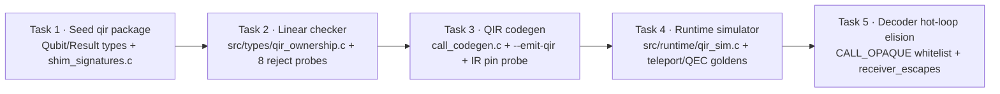

# Phase 7 Milestone 1 — Linear `Qubit` Ownership & QIR Adaptive-Profile Codegen (Design)

**Date:** 2026-11-24  
**Status:** Draft (Design Spec)  
**Track:** Phase 7 (Hybrid Quantum–Classical Control & Real-Time QEC) — builds on `src/types/lane_ownership.c` (Phase 6 M1), `src/types/escape_core.c` / `src/types/release_decision.c` (ADR 0002 / ADR 0005), and `src/compiler/program_dump.c` (Phase 0 front-end interchange).

---

## 1. Definition

Milestone 1 delivers a **compiler-enforced linear `Qubit` type and a QIR (Quantum Intermediate Representation) Adaptive-Profile backend**, demonstrated by a real-time quantum teleportation circuit and a 3-qubit repetition-code syndrome-decoding loop with compile-time-synthesized parity checks.

Concretely, at the end of M1:

1. **Compile-time quantum safety (No-Cloning, No-Aliasing, Safe Uncomputation / No-Drop):**  
   `qir.Qubit` handles are **linear** (move-only, must-consume, non-aliasing). The compiler rejects at compile time any program that:
   - uses a `qir.Qubit` after moving or freeing it (`ERROR_USE_AFTER_MOVE`),
   - passes the same `qir.Qubit` binding to two parameters of a multi-qubit gate or function, e.g. `qir.CX(q, q)` (`ERROR_INVALID_BORROW`),
   - lets a `qir.Qubit` exit its lexical scope or a function `return` without being explicitly consumed or returned (`ERROR_UNCONSUMED_LINEAR`),
   - consumes or moves an outer `qir.Qubit` on one branch of an `if`/`else`, `switch`, or `match` without matching consumption on all sibling branches,
   - consumes an outer `qir.Qubit` inside a `for` loop body, or
   - stores a `qir.Qubit` into a heap container (slice, array, map, struct field, channel, interface box) or captures it across a `go`, closure, or `defer` boundary.
2. **Direct QIR Adaptive-Profile LLVM IR emission (`--emit-qir`):**  
   `bin/goo --emit-qir prog.goo` lowers `qir.*` calls directly to QIR 1.0 LLVM intrinsics (`@__quantum__qis__*__body`, `@__quantum__rt__*`) and stamps the entry point with QIR profile attributes (`"entry_point"`, `"qir_profiles"="adaptive_profile"`, `"required_num_qubits"`, `"required_num_results"`), while compiling classical feed-forward branches (`if qir.ReadResult(r)`), `comptime` stabilizer tables, and zero-allocation syndrome decoders into the same LLVM module.
3. **Executable golden verification via a minimal C stabilizer/statevector shim:**  
   Under normal native builds (`bin/goo prog.goo`), the runtime archive (`src/runtime/qir_sim.c`) provides an embedded $\le 16$-qubit statevector implementation of the `@__quantum__qis__*` and `@__quantum__rt__*` symbols, so hybrid quantum–classical `.goo` programs run end-to-end in `make test-golden` at `-O0` and `-O2`.

### Explicit Non-Goals (M1 Scope Boundary)

- **No general user-defined `linear` keyword across arbitrary structs in M1:** Following `lane_ownership.c`'s Option A scope boundary (`include/lane_ownership.h:31-42`), linearity is enforced on the compiler-seeded `qir.Qubit` type. A program that does not import `"qir"` pays zero compile-time overhead.
- **No automatic adjoint/uncomputation synthesis (`within { ... } apply { ... }`) in the C front-end:** M1 enforces explicit terminal consumption (`qir.FreeZero(q)` vs `qir.MeasureReset(q)`). Structural synthesis of conjugate uncomputation blocks is deferred to the Haskell front-end consuming `--emit-program` JSON (Section 7).
- **No pulse-level schedule lowering:** M1 targets the QIR 1.0 Adaptive Profile (unitary gates, mid-circuit projective measurements, resets, and sub-microsecond classical branching).

---

## 2. Why Goo Fits Hybrid Quantum–Classical Control

Existing quantum DSLs split into two camps that fail at the hardware control boundary:

1. **Python DSLs (Qiskit, Cirq, PennyLane, Guppy-in-Python):** Good at high-level circuit construction, unusable for hard real-time syndrome decoding inside the coherence window ($< 1\,\mu\text{s}$ per round on superconducting hardware) without rewriting the decoder in C++/Rust and crossing an FFI boundary.
2. **Functional / Linear Circuit Languages (Quipper, Silq, Haskell QIO):** Enforce no-cloning and safe uncomputation via linear/dependent types, but rely on a garbage-collected runtime (GHC RTS) or lack deterministic, zero-allocation imperative hot loops for real-time decoding (e.g., Union-Find or MWPM over spacetime syndrome graphs).

Goo already has all four pillars needed to unify circuit safety and real-time classical decoding in a single compilation unit:

- **LLVM 22 Backend (`src/codegen/`):** QIR is a restricted profile of LLVM IR. Emitting `@__quantum__qis__*` calls alongside native LLVM `br i1` instructions and scalar loops requires no external transpiler.
- **Deterministic No-GC Memory Model (`src/types/escape_core.c`, `src/types/release_decision.c`):** ADR 0002 + ADR 0003 proved that pre-allocated scalar/slice loops in Goo perform zero heap allocations and execute at exact scalar parity with Rust (`0.86s` vs `0.86s`).
- **Zig-style `comptime` (`src/comptime/`, `src/codegen/monomorphize.c`):** Quantum error-correcting codes are parameterized by code distance $d$, stabilizer generators, and hardware coupling maps. Goo's `comptime` evaluator computes parity-check matrices and unrolls syndrome rounds at compile time with zero runtime metaprogramming overhead.
- **Existing AST Ownership & Escape Passes (`src/types/lane_ownership.c`):** Goo already enforces move-on-call, single-consumption, and no-goroutine/closure escape for `lanes.Partition` / `lanes.Run`.

---

## 3. What Already Exists to Build On

| Subsystem | Existing File(s) | What It Provides | What M1 Adds / Extends |
| :--- | :--- | :--- | :--- |
| **Opaque shim types** | `src/types/type_checker.c` (`seed_sync_package_exports`, `seed_os_package_exports`, lines 850–1011) | Mints compiler-known types (`sync.Mutex`, `os.File`) in a shim package's `exports` scope, wired into both `goo.c` and `type_checker.c`. | `seed_qir_package_exports` mints `qir.Qubit` and `qir.Result` as distinct opaque handle types (`owner_package = qir`). |
| **Declarative shim signatures** | `include/shim_signatures.h`, `src/types/shim_signatures.c` | Validates call arity, parameter types, and `non_retaining` status for stdlib shims. | Add `"qir"` rows (`Alloc`, `QubitAt`, `FreeZero`, `H`, `X`, `Y`, `Z`, `S`, `SAdj`, `T`, `TAdj`, `Rx`, `Ry`, `Rz`, `CX`, `CZ`, `CCX`, `Mz`, `Reset`, `MeasureReset`, `ReadResult`) with `SHIM_PARAM_QUBIT` / `SHIM_PARAM_QRESULT`. |
| **Move & consume AST pass** | `include/lane_ownership.h`, `src/types/lane_ownership.c` | Per-function post-Pass-2 AST walk enforcing move, single-consume, and closure/goroutine capture rules. | New `src/types/qir_ownership.c` upgrading `lane_ownership`'s affine walk to a **strictly linear, branch-joining, total statement walk** over `qir.Qubit` bindings. |
| **ARC release elision** | `include/release_decision.h`, `src/types/release_decision.c` | Decides which function-local bindings emit `goo_release` at scope/iteration exit. | `qir.Qubit` and `qir.Result` carry no ARC object header (`GOO_OBJ_HEADER_SIZE`); `release_decision` classifies them `RELEASE_NO_NOT_OWNED` so `goo_release` is never emitted on a QIR handle. |
| **Intrinsic call lowering** | `src/codegen/call_codegen.c`, `src/codegen/runtime_integration.c` | Lowers `math.*`, `os.*`, `sync.*` calls directly to LLVM function declarations. | Lowers `qir.*` calls directly to `@__quantum__qis__*__body` and `@__quantum__rt__*` declarations using LLVM 22 `ptr` (opaque pointer) ABI. |
| **Typed JSON IR dump** | `src/compiler/program_dump.c` (`feat/phase0-program-dump`), `catalogue/diagnostics.tsv` | Emits canonical typed AST + type table + `ReleasePlan` JSON for front-end parity checking (`scripts/frontend_diff.sh`). | Exports `qir.Qubit` / `qir.Result` as named struct types owned by `"qir"` and pins all `qir_ownership.c` diagnostic strings in `catalogue/diagnostics.tsv`. |

---

## 4. Architecture

### Component 1 — The `qir` Package Surface & Linear Handle Model

There are two ways to spell linear gate application in a procedural syntax:
1. **Pure value-threading:** `q1, q2 = qir.CX(q1, q2)` (every gate moves its inputs and returns new handles).
2. **Linear handle with in-place unitary borrow and explicit terminal consumption:** Unitary gates (`qir.H(q)`, `qir.CX(c, t)`) require live, distinct `qir.Qubit` bindings and leave them live in the same state; allocation (`qir.Alloc`, `qir.QubitAt`) creates a live binding; terminal operations (`qir.FreeZero`, `qir.MeasureReset`) or transferring ownership (move assignment `q2 := q1`, `return q`, or passing to a consuming function) consume the binding.

**Decision:** M1 adopts **Model 2 (Linear handle with in-place unitary borrows + explicit move/consume)**.
- **Why:** It maps 1-to-1 onto Go's imperative syntax and QIR's `void @__quantum__qis__*__body(ptr, ...)` ABI without synthetic tuple-destructuring noise on every 2- and 3-qubit gate, while **still enforcing all six linear type guarantees at compile time** because `qir.Qubit` cannot be copied, aliased in a call, or dropped without consumption.
- **Value-threading compatibility:** Because assignment (`q2 := q1`) is a move and `return q` transfers ownership out of a helper function, users can write functional combinators (`func bell(a, b qir.Qubit) (qir.Qubit, qir.Qubit)`) and the exact same linear rules verify them.

#### Public `qir` API (`import "qir"`)

```goo
package qir

// Opaque linear handle to a hardware/simulator qubit.
// Lowered to LLVM `ptr` (%Qubit* in QIR 1.0).
// May NOT be copied, stored in containers, captured by closures/goroutines,
// or dropped at scope exit without consumption.
type Qubit struct { /* opaque, compiler-seeded */ }

// Opaque classical handle to a measurement result register/slot.
// Lowered to LLVM `ptr` (%Result* in QIR 1.0). Copyable classical handle.
type Result struct { /* opaque, compiler-seeded */ }

// --- Lifecycle & Addressing (Producers & Consumers) ------------------------

// Dynamic allocation/reclamation (QIR runtime intrinsics):
//   @__quantum__rt__qubit_allocate() -> ptr
//   @__quantum__rt__qubit_release(ptr) -> void
func Alloc() Qubit                // produces a fresh LIVE Qubit in |0>
func FreeZero(q Qubit)            // CONSUMES q; caller asserts q is unentangled |0>
func MeasureReset(q Qubit) bool   // CONSUMES q: measures in Z, resets, releases, returns bit

// Static QIR Adaptive-Profile addressing (compile-time index -> inttoptr):
// Acquires static hardware qubit `id` as a linear handle within the function.
// Duplicate active QubitAt(id) with the same comptime `id` in the same scope
// is rejected at compile time (static no-cloning).
func QubitAt(comptime id int) Qubit
func ResultAt(comptime id int) Result

// --- Single-Qubit Unitary Gates (Linear Borrow: requires LIVE q, keeps q LIVE) ---

func H(q Qubit)
func X(q Qubit)
func Y(q Qubit)
func Z(q Qubit)
func S(q Qubit)
func SAdj(q Qubit)
func T(q Qubit)
func TAdj(q Qubit)
func Rx(theta float64, q Qubit)
func Ry(theta float64, q Qubit)
func Rz(theta float64, q Qubit)

// --- Multi-Qubit Unitary Gates (Linear Borrow: requires LIVE & DISTINCT operands) ---

func CX(control Qubit, target Qubit)
func CZ(control Qubit, target Qubit)
func Swap(a Qubit, b Qubit)
func CCX(c1 Qubit, c2 Qubit, target Qubit)

// --- Mid-Circuit Measurement, Reset & Feed-Forward -------------------------

// Projective Z-basis measurement into result slot `r`.
// Keeps `q` LIVE (projected into |0> or |1>) for subsequent syndrome rounds.
// Lowers to: call void @__quantum__qis__mz__body(ptr %q, ptr %r)
func Mz(q Qubit, r Result)

// Reset `q` to |0>. Keeps `q` LIVE.
// Lowers to: call void @__quantum__qis__reset__body(ptr %q)
func Reset(q Qubit)

// Read a measurement result as a classical bool for real-time branching.
// Lowers to: call i1 @__quantum__rt__read_result(ptr %r)
func ReadResult(r Result) bool
```

---

### Component 2 — The Six Linear Proof Obligations (`src/types/qir_ownership.c`)

`qir_ownership_check_program(TypeChecker* checker, ASTNode* program)` runs immediately after `lane_ownership_check_program` in `type_check_program` (`src/types/type_checker.c:834`).

For every function declaration (`AST_FUNC_DECL`), the checker maintains a scoped linear binding table `QirBindingTable`:

```c
typedef enum {
    QIR_STATE_LIVE = 0,      // Holds a valid Qubit handle; MUST be consumed before scope exit
    QIR_STATE_MOVED,         // Ownership transferred to another binding or returned
    QIR_STATE_CONSUMED,      // Released via qir.FreeZero or qir.MeasureReset
} QirBindingState;

typedef struct {
    const char*     name;          // Borrowed AST identifier string
    QirBindingState state;
    Position        decl_pos;      // Where the binding was introduced
    Position        transition_pos;// Where it was moved or consumed (for diagnostics)
    int             scope_depth;   // Lexical block depth (0 = function params/top-level)
    int             loop_depth;    // Enclosing `for` loop depth at declaration site
    int             has_static_id; // 1 if bound via qir.QubitAt(comptime id)
    uint64_t        static_id;     // Comptime qubit ID (when has_static_id == 1)
} QirBinding;
```

#### Obligation 1 — Move-Only Semantics & Container Ban (No-Cloning)
- **Producer sites:** A variable declaration (`:=` or `var`) or assignment of type `qir.Qubit` may only take its RHS from:
  1. `qir.Alloc()` or `qir.QubitAt(id)`,
  2. a user function call returning `qir.Qubit` (or tuple containing `qir.Qubit`), or
  3. another live `qir.Qubit` identifier `src` — which transitions `src` to `QIR_STATE_MOVED` at `transition_pos`.
- **Use-after-move / use-after-consume:** Any read of a binding in `QIR_STATE_MOVED` or `QIR_STATE_CONSUMED` emits a positioned error:
  - `MOVED`: `"use of moved linear qubit '%s' (moved at line %d)"`
  - `CONSUMED`: `"use of consumed linear qubit '%s' (consumed at line %d)"`
- **Rebinding before consumption is forbidden:** Assigning a new value to a `qir.Qubit` variable `q = ...` while `q` is in `QIR_STATE_LIVE` is rejected (`"cannot overwrite live linear qubit '%s' (allocated at line %d) without consuming it first"`). If `q` is `MOVED` or `CONSUMED`, rebinding revives `q` as `QIR_STATE_LIVE`.
- **Container & indirection ban:** The type checker rejects constructing `*qir.Qubit`, `[]qir.Qubit`, `[N]qir.Qubit`, `map[K]qir.Qubit`, `map[qir.Qubit]V`, `chan qir.Qubit`, a struct field of type `qir.Qubit`, or boxing `qir.Qubit` into an `interface{}` / `any` (`"linear type 'qir.Qubit' cannot be stored in a container, struct, channel, or interface"`).
- **Static ID uniqueness:** Within a function, two simultaneously `LIVE` bindings produced by `qir.QubitAt(id)` with the same folded `comptime` integer `id` are rejected (`"static hardware qubit %llu is already active in binding '%s' (line %d)"`).

#### Obligation 2 — Distinct Operands in Multi-Qubit Calls (No-Aliasing)
- At every `AST_CALL_EXPR` (both `qir.*` intrinsics like `qir.CX(c, t)`, `qir.CZ(a, b)`, `qir.Swap(a, b)`, `qir.CCX(c1, c2, t)` and user-defined functions taking multiple `qir.Qubit` parameters):
  - Every `qir.Qubit` argument must be a bare identifier resolving to a `QIR_STATE_LIVE` binding (or a direct producer call if the parameter consumes it).
  - For all pairs of `qir.Qubit` arguments $(i, j)$ with $i < j$, if `arg[i].name == arg[j].name` (or both have `has_static_id && static_id_i == static_id_j`), the checker rejects the call:
    `"quantum operation requires distinct qubit arguments; '%s' passed as both argument %zu and argument %zu"`.

#### Obligation 3 — Must-Consume before Scope Exit & Return (Safe Uncomputation)
- **Block exit:** When exiting a lexical block at `scope_depth == D`, every binding declared at depth `D` must have `state != QIR_STATE_LIVE`. Any binding still in `QIR_STATE_LIVE` triggers:
  `"linear qubit '%s' (declared at line %d) exited scope without being consumed by qir.FreeZero, qir.MeasureReset, or returned"`.
- **Early and normal `return`:** At every `AST_RETURN_STMT`:
  1. Any `qir.Qubit` identifier returned by the statement transitions from `QIR_STATE_LIVE` to `QIR_STATE_MOVED`.
  2. Every remaining local or parameter binding at *any* enclosing `scope_depth <= current_depth` that is still in `QIR_STATE_LIVE` is rejected:
     `"linear qubit '%s' (declared at line %d) is still live at return; consume or return it before exiting"`.
- **Function fallthrough exit:** At the end of a function body, if the function can fall through without a `return`, all bindings at depth `0` (including `qir.Qubit` parameters that were not returned or consumed) must be `MOVED` or `CONSUMED`.
  - *Parameter convention:* To keep helper functions (`func applyStabilizer(d1, d2, anc qir.Qubit)`) ergonomic without requiring `d1, d2, anc = applyStabilizer(d1, d2, anc)` when a helper only applies unitary gates, a parameter of type `qir.Qubit` is treated as a **linear borrow by default** if the function signature returns no `qir.Qubit`: the parameter starts `LIVE`, **must remain `LIVE` at all return paths** (the callee may not call `qir.FreeZero` on a borrowed parameter), and the caller's argument stays `LIVE` after the call. Conversely, `qir.FreeZero` and `qir.MeasureReset` are registered as **consuming callees** that transition the caller's argument to `QIR_STATE_CONSUMED`.

#### Obligation 4 — Branch-Join State Agreement (`if`/`else`, `switch`, `match`, `if let`)
- Before walking a branching construct, the checker snapshots `QirBindingTable` (`pre_branch_table`) for all bindings at `scope_depth <= current_depth`.
- Each branch arm (`then` vs `else`, or each `case`/`default`) is walked starting from a clone of `pre_branch_table`.
  - If an `if` statement has no `else` branch, the implicit fallthrough arm has the unmodified `pre_branch_table` state.
  - Similarly, a `switch` without a `default` branch (or a non-exhaustive `match`) includes the unmodified `pre_branch_table` as an implicit fallthrough arm.
  - Branches that terminate unconditionally (`return` or `panic`) do not participate in the post-branch join (their obligations were already verified at their `return` site by Obligation 3).
- At the join point after the construct, for every pre-existing binding `b`:
  - All non-terminating arms must agree on `b.state` (`LIVE` in all arms, or `MOVED`/`CONSUMED` in all arms).
  - If arm $A$ leaves `b` in `CONSUMED`/`MOVED` while arm $B$ leaves `b` in `LIVE`, the checker emits:
    `"linear qubit '%s' (declared at line %d) is consumed on one branch (line %d) but remains live on another branch"`.

#### Obligation 5 — Loop Invariance (`for`)
- While walking a `for` loop body at `loop_depth == L`:
  - Any binding `b` with `b.loop_depth < L` (declared outside the loop) may be passed to unitary gates, `qir.Mz`, or `qir.Reset` (which preserve `QIR_STATE_LIVE`), but **may not** transition to `QIR_STATE_MOVED` or `QIR_STATE_CONSUMED` inside the loop body:
    `"outer linear qubit '%s' (declared at line %d) cannot be moved or consumed inside a loop"`.
  - Any binding `b` declared *inside* the loop body (`b.loop_depth == L`) is checked at `break`, `continue`, and normal loop-body end by Obligation 3's block-exit rule: it must be consumed before the iteration ends.

#### Obligation 6 — Concurrency, Closure & Defer Isolation
- **No `go` escape:** Passing a `qir.Qubit` as an argument to a `go` statement (`AST_GO_STMT`) is rejected (`"linear qubit '%s' may not be passed to a goroutine"`).
- **No closure capture:** Walking an `AST_FUNC_LIT` checks `FuncLitNode.captured_names` (populated during Pass 2, matching `lane_ownership.c`'s Obligation 4). If any captured name resolves to a `qir.Qubit` binding, the literal is rejected (`"closure may not capture linear qubit '%s'"`).
- **No `defer`:** Passing a `qir.Qubit` to a `defer` statement (`AST_DEFER_STMT`) is rejected in M1 (`"linear qubit '%s' may not be passed to defer; consume it explicitly"`), keeping control-flow lifetime analysis strictly lexical.

---

### Component 3 — Total Statement Coverage (Closing `lane_ownership.h`'s Under-Walked List)

`include/lane_ownership.h:49-77` documents six statement kinds that `lane_walk_stmt` does not descend into (`AST_IF_LET_STMT`, `AST_SELECT_STMT`, `AST_ARENA_BLOCK`, `AST_UNSAFE_STMT`, `AST_COMPTIME_BLOCK`, local `AST_CONST_DECL`). For `lane_ownership`, skipping a statement under-rejects. For a **must-consume linear checker**, skipping a statement could miss a consumption or a move and cause a false diagnostic or an undetected clone.

`qir_ownership.c` therefore enforces a **total statement walk** whenever `qir` is imported:
- `AST_BLOCK`, `AST_VAR_DECL`, `AST_CONST_DECL`, `AST_EXPR_STMT`, `AST_ASSIGN_EXPR`, `AST_MULTI_ASSIGN`, `AST_RETURN_STMT`, `AST_IF_STMT`, `AST_IF_LET_STMT`, `AST_FOR_STMT`, `AST_RANGE_STMT`, `AST_SWITCH_STMT`, `AST_TYPE_SWITCH_STMT`, `AST_MATCH_EXPR`/`AST_MATCH_STMT`, `AST_ARENA_BLOCK`, `AST_LABEL_STMT`, `AST_BREAK_STMT`, `AST_CONTINUE_STMT`, `AST_GO_STMT`, `AST_DEFER_STMT` are all explicitly walked.
- `AST_SELECT_STMT` and `AST_UNSAFE_STMT`: walked, and any read/move/consume of a `qir.Qubit` inside `select` or `unsafe` is rejected (`"linear qubit '%s' may not be used inside '%s'"`).
- `default:` arm (fail-closed soundness rule): if a function has any `qir.Qubit` binding in its table and encounters an unrecognized `ASTNodeType`, the checker emits an internal diagnostic rather than silently skipping the subtree.

---

### Component 4 — QIR Adaptive-Profile Codegen (`--emit-qir` in `src/codegen/`)

#### 4.1 Type Representation & ARC Exemption
- In `src/codegen/codegen.c` (`codegen_type_to_llvm`), `qir.Qubit` and `qir.Result` lower to `LLVMPointerTypeInContext(codegen->context, 0)` (`ptr` in LLVM 22 opaque-pointer IR), which is the exact representation LLVM 22 uses for QIR's `%Qubit*` and `%Result*` opaque struct pointers.
- In `src/types/release_decision.c`, `is_arc_releasable_type` (and the binding-site table) returns `false` (`RELEASE_NO_NOT_OWNED`) for `qir.Qubit` and `qir.Result`. Neither type carries a `GOO_OBJ_HEADER_SIZE` reference-count header, and codegen never emits `goo_retain` or `goo_release` for them.

#### 4.2 Intrinsic Lowering Table (`src/codegen/call_codegen.c`)

When `call_codegen.c` intercepts a call to package `"qir"`, it emits the corresponding QIR instruction or intrinsic declaration on demand via `LLVMGetNamedFunction` / `LLVMAddFunction`:

| Goo Call | Emitted LLVM 22 IR (`--emit-qir` / default) |
| :--- | :--- |
| `qir.Alloc()` | `call ptr @__quantum__rt__qubit_allocate()` |
| `qir.FreeZero(q)` | `call void @__quantum__rt__qubit_release(ptr %q)` |
| `qir.QubitAt(N)` | `inttoptr (i64 <N> to ptr)` (constant-folded at compile time!) |
| `qir.ResultAt(M)` | `inttoptr (i64 <M> to ptr)` (constant-folded at compile time!) |
| `qir.H(q)` | `call void @__quantum__qis__h__body(ptr %q)` |
| `qir.X(q)` / `Y` / `Z` | `call void @__quantum__qis__x__body(ptr %q)` (and `y`, `z`) |
| `qir.S(q)` / `SAdj(q)` | `call void @__quantum__qis__s__body(ptr %q)` / `s__adj` |
| `qir.T(q)` / `TAdj(q)` | `call void @__quantum__qis__t__body(ptr %q)` / `t__adj` |
| `qir.Rx(theta, q)` / `Ry` / `Rz` | `call void @__quantum__qis__rx__body(double %theta, ptr %q)` |
| `qir.CX(c, t)` | `call void @__quantum__qis__cnot__body(ptr %c, ptr %t)` |
| `qir.CZ(c, t)` | `call void @__quantum__qis__cz__body(ptr %c, ptr %t)` |
| `qir.Swap(a, b)` | `call void @__quantum__qis__swap__body(ptr %a, ptr %b)` |
| `qir.CCX(c1, c2, t)` | `call void @__quantum__qis__ccx__body(ptr %c1, ptr %c2, ptr %t)` |
| `qir.Mz(q, r)` | `call void @__quantum__qis__mz__body(ptr %q, ptr %r)` |
| `qir.Reset(q)` | `call void @__quantum__qis__reset__body(ptr %q)` |
| `qir.ReadResult(r)` | `call i1 @__quantum__rt__read_result(ptr %r)` |
| `qir.MeasureReset(q)` | Allocates/uses a scratch result or calls `@__quantum__qis__mresetz__body(ptr %q, ptr %r)` + `@__quantum__rt__read_result(ptr %r)` + `@__quantum__rt__qubit_release(ptr %q)` |

#### 4.3 `--emit-qir` CLI Flag & Entry-Point Attributes
Adding `--emit-qir` to `src/compiler/goo.c`:
1. Sets `options->emit_llvm_ir = true` and `codegen->qir_mode = 1`.
2. Tracks the maximum static qubit index (`max_static_qubit_id + 1` plus dynamic `qir.Alloc` count) and result index (`max_static_result_id + 1`) encountered during codegen.
3. Stamps `main` (or `@goo_qir_main`) with the QIR 1.0 Adaptive Profile string attributes via `LLVMAddTargetDependentFunctionAttr`:
   - `"entry_point"`
   - `"qir_profiles" = "adaptive_profile"`
   - `"output_labeling_schema" = "schema_id"`
   - `"required_num_qubits" = "<N>"`
   - `"required_num_results" = "<M>"`
4. Suppresses emitting the POSIX `argv`/`os.Args` copy prologue inside `main` when `qir_mode == 1`, keeping the entry function QIR-verifier clean.

---

### Component 5 — Closing the Real-Time QEC Decoder Hot-Loop Gaps

A real-time QEC syndrome decoder runs in the same LLVM module right after `qir.ReadResult(r)`:

```goo
// Comptime-synthesized parity-check matrix for a [7,1,3] Steane or 3-qubit code
comptime const NUM_SYNDROMES int = 2

func decodeBitFlip(s0 bool, s1 bool, q0 qir.Qubit, q1 qir.Qubit, q2 qir.Qubit) {
    if s0 && !s1 {
        qir.X(q0)
    } else if !s0 && s1 {
        qir.X(q2)
    } else if s0 && s1 {
        qir.X(q1)
    }
}
```

For larger codes (surface codes / qLDPC codes decoded via Union-Find or belief propagation over pre-allocated `Decoder` structs and slices), `CLAUDE.md` named two precision ceilings in the ARC elision pass that would otherwise inhibit local release elision inside helper methods:

1. **`CALL_OPAQUE` Builtin Whitelist (`src/types/escape_core.c`):**  
   Currently, builtin calls and scalar type conversions (`int(x)`, `uint64(x)`, `float64(x)`, `byte(x)`, `rune(x)`, `len(s)`, `cap(s)`) fall through to `ESCAPE_REASON_CALL_OPAQUE` (578 of 655 call-refused locals in the corpus, `include/escape_core.h:179-195`). M1 adds a pure-builtin whitelist in `escape_core.c`'s `AST_CALL_EXPR` arm so scalar conversions and `len`/`cap` propagate **zero** escape taint to their arguments and return an empty `TaintSet`.
2. **`CALLEE_VALUE` Receiver Escape Summary (`src/types/param_escape.c`):**  
   Currently, calling `dec.ResetSyndrome()` marks `dec` with `ESCAPE_REASON_CALLEE_VALUE` (`include/escape_core.h:129-147`) because `ParamEscapeSummary` summarizes `param[0..n-1]` (`call->args`), not the method's receiver (`sel->expr`). M1 adds `bool receiver_escapes` to `ParamEscapeSummary` (seeded as slot 0 on `FuncDeclNode.receiver` in `param_escape.c`). When `callee_retention` reports `receiver_escapes == false`, `escape_expr_taint` does not raise `ESCAPE_REASON_CALLEE_VALUE` on `sel->expr`.

---

### Component 6 — Embedded 16-Qubit Simulator Shim (`src/runtime/qir_sim.c`)

In accordance with `CLAUDE.md`'s rule (**"a claim counts only if a probe in `make verify-core` passes on it"**), QIR codegen must not merely emit `.ll` text—compiled quantum programs must execute and pass deterministic golden tests.

- `src/runtime/qir_sim.c` (~220 lines of C23, linked into `libgooruntime.a`) implements the `@__quantum__qis__*__body` and `@__quantum__rt__*` symbols over a thread-local 16-qubit complex statevector ($2^{16} \times 16\,\text{bytes} = 1\,\text{MB}$, allocated lazily on first quantum op).
- Deterministic PRNG seeding (`GOO_QIR_SEED`, defaulting to a fixed seed `0x51495231` when unset) ensures mid-circuit projective measurements (`@__quantum__qis__mz__body`) collapse the statevector and produce bit-for-bit reproducible outcomes across `-O0` and `-O2` golden runs, while still testing both $|0\rangle$ and $|1\rangle$ branch outcomes (e.g., in quantum teleportation, Bell states, and injected-error QEC rounds).

---

### Component 7 — `--emit-program` JSON Interchange & Haskell Front-End Alignment

To keep `feat/phase0-program-dump` (`docs/superpowers/specs/2026-09-04-program-dump-format.md`) green and ready for the Haskell front-end:
1. `qir.Qubit` and `qir.Result` serialize in the `types` array of `--emit-program` as named `struct` types with `"package": "qir"`, `"name": "Qubit"` / `"Result"` (zero changes needed to the JSON schema in `src/compiler/program_dump.c`, because `seed_qir_package_exports` stamps `owner_package` identically to `sync.Mutex`).
2. All diagnostic format strings emitted by `src/types/qir_ownership.c` are registered in `catalogue/diagnostics.tsv` so `diagnostics-drift-probe` passes and the Haskell front-end can match reject fixtures byte-for-byte.
3. Because `qir.Qubit` is classified `RELEASE_NO_NOT_OWNED`, every `qir.Qubit` local appears in the typed dump's `"plan"` array with `"verdict": "NO_NOT_OWNED"`, preserving `program_dump_check.py`'s structural invariants.

---

## 5. Testing & Acceptance Gates (`make verify-core`)

Every deliverable is gated in `make verify-core`, ordered safety-first:

1. **`qir-linear-reject-probe` (`scripts/qir_linear_reject_probe.sh`):**  
   Compile-must-fail + stderr diagnostic substring check across 8 negative fixtures (`tests/reject/qir_*.goo`):
   - `qir_use_after_free.goo`: `qir.FreeZero(q); qir.H(q)` → `"use of consumed linear qubit 'q'"`
   - `qir_double_free.goo`: `qir.FreeZero(q); qir.FreeZero(q)` → `"use of consumed linear qubit 'q'"`
   - `qir_use_after_move.goo`: `q2 := q1; qir.H(q1)` → `"use of moved linear qubit 'q1'"`
   - `qir_unconsumed_scope_exit.goo`: `q := qir.Alloc()` with no `FreeZero`/`MeasureReset` before `return` → `"exited scope without being consumed"`
   - `qir_alias_cx.goo`: `qir.CX(q, q)` → `"requires distinct qubit arguments; 'q' passed as both argument 1 and argument 2"`
   - `qir_branch_mismatch.goo`: `if cond { qir.FreeZero(q) }` (no `else`) → `"consumed on one branch"`
   - `qir_loop_consume.goo`: outer `q` passed to `qir.FreeZero(q)` inside `for` → `"outer linear qubit 'q' (declared at line ...) cannot be moved or consumed inside a loop"`
   - `qir_escape_closure_go.goo`: `go func() { qir.H(q) }()` and `s := []qir.Qubit{q}` → `"cannot be stored in a container"` / `"closure may not capture linear qubit"`
   *Teeth check (`--self-test`):* asserts that commenting out the `qir_ownership_check_program` call causes the probe to fail loudly.
2. **`qir-ir-pin-probe` (`scripts/qir_ir_pin_probe.sh`):**  
   Compiles `examples/qir_bitflip_qec_probe.goo` with `./bin/goo --emit-qir`:
   - Pins the presence of `@__quantum__qis__h__body`, `@__quantum__qis__cnot__body`, `@__quantum__qis__mz__body`, `@__quantum__rt__read_result`, `"entry_point"`, `"qir_profiles"="adaptive_profile"`, and `"required_num_qubits"`.
   - Asserts **0 occurrences** of `@goo_release` or `@goo_retain` on `%Qubit` / `%Result` handles and **0 occurrences** of `@goo_alloc` inside the syndrome-decoding function body.
3. **End-to-end Golden Fixtures (`make test-golden` & `make test-golden-o2`):**
   - `examples/qir_teleport_probe.goo` (+ `.expected.txt`): Prepares a $|\psi\rangle = R_y(\theta)|0\rangle$ state, entangles a Bell pair, performs Bell-basis measurement (`qir.Mz`), applies classical feed-forward `qir.X` / `qir.Z` corrections conditioned on `qir.ReadResult`, uncomputes via $R_y(-\theta)$, and verifies the teleported qubit measures deterministically to `0` across 64 shots.
   - `examples/qir_bitflip_qec_probe.goo` (+ `.expected.txt`): 3-qubit bit-flip code with `comptime`-generated stabilizer syndrome table, injecting single-qubit $X$ faults on each data qubit and verifying real-time syndrome measurement + feed-forward recovery restores the logical state across all fault locations.
4. **`escape-builtin-receiver-probe`:**  
   Unit rows in `local-escape-test` and `release-decision-test` verifying that `len(s)` / `int(x)` no longer raise `ESCAPE_REASON_CALL_OPAQUE` and that calling a non-escaping value/pointer method on a local struct no longer raises `ESCAPE_REASON_CALLEE_VALUE`.

---

## 6. Staged Implementation Order



1. **Task 1 — Seed `"qir"` package & signatures:** Add `seed_qir_package_exports` in `src/types/type_checker.c`, wire `"qir"` into `is_stdlib_shim_import` (`src/compiler/goo.c`), and add `SHIM_PARAM_QUBIT` / `SHIM_PARAM_QRESULT` rows in `src/types/shim_signatures.c`. (Zero grammar changes; `scripts/grammar-tripwire.sh` conflict count stays untouched.)
2. **Task 2 — `src/types/qir_ownership.c` & reject suite:** Implement the 6 linear obligations, register diagnostics in `catalogue/diagnostics.tsv`, and wire `qir-linear-reject-probe` into `make verify-core`.
3. **Task 3 — QIR intrinsic lowering & `--emit-qir`:** Lower `qir.*` calls in `src/codegen/call_codegen.c`, exempt `qir.Qubit`/`qir.Result` in `release_decision.c`, add `--emit-qir` attribute stamping, and gate with `qir-ir-pin-probe`.
4. **Task 4 — `src/runtime/qir_sim.c` & golden probes:** Add the 16-qubit statevector runtime shim and land `qir_teleport_probe.goo` and `qir_bitflip_qec_probe.goo` in the `-O0`/`-O2` golden suites.
5. **Task 5 — Hot-loop escape precision (`CALL_OPAQUE` & `CALLEE_VALUE`):** Land the pure-builtin whitelist in `src/types/escape_core.c` and `receiver_escapes` in `src/types/param_escape.c`, re-running `./scripts/arc_reason_census.sh` to record the measured local-release delta.
